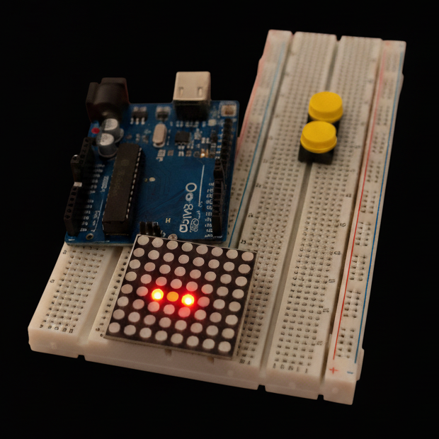

# 🐍 Arduino Snake Game


The classic Snake game on an **8×8 LED matrix**, driven directly by an Arduino Uno with two push buttons and no extra libraries or driver chips.


<sub>Real photo of the build, edited with AI to remove the jumper wires so the components are easier to see.</sub>

## How it works

- The snake moves one cell every 400 ms and **wraps around** the edges, so leaving one side brings it back on the other.
- Eating the food makes it one cell longer and spawns new food at a random position.
- Running into its own body resets the game to a 3-cell snake.
- **Controls:** the **UP** button turns the snake upwards and the **LEFT** button turns it left. With wrap-around, those two directions are enough to reach every cell.

The matrix is **multiplexed in software**: `drawScreen()` lights one row at a time and scans its eight columns, fast enough that the eye sees a still image.
The snake is an array of up to 64 points (the whole board), and each frame is rendered into an 8-byte buffer, one bit per LED.

## Hardware

- Arduino Uno (or Nano)
- 8×8 LED matrix (multiplexed, 16 pins)
- 2 push buttons
- Breadboard and jumper wires

## Wiring

| Arduino pin | Connected to |
| --- | --- |
| 2 – 9 | Matrix rows 1 – 8 |
| 10 – 13 | Matrix columns 1 – 4 |
| A0 – A3 | Matrix columns 5 – 8 |
| A5 | UP button (other leg to GND) |
| A4 | LEFT button (other leg to GND) |

The buttons use the internal `INPUT_PULLUP` resistors, so no external resistors are needed.

## Running it

1. Wire everything as above.
2. Open `snakeGame.ino` in the Arduino IDE, choose **Arduino Uno** and the right port, and click **Upload**.

Or from the command line with [arduino-cli](https://arduino.github.io/arduino-cli/):

```bash
arduino-cli core install arduino:avr
arduino-cli compile -b arduino:avr:uno --upload -p <port> .
```

The sketch uses about 2.4 KB of flash and 171 bytes of RAM.
